# Arquitectura Azure PaaS: Decisión y Topología de Tres Capas

## Contexto

Este documento presenta la decisión de utilizar **PaaS sobre IaaS** y la arquitectura desacoplada en tres capas dentro del grupo de recursos `rg-tesis-arquitectura`.

## Diagrama Mermaid: Topología en Azure PaaS

```mermaid
flowchart TD
    classDef iaas fill:#7f8c8d,stroke:#ffffff,stroke-width:2px,color:#ffffff,stroke-dasharray: 5 5;
    classDef paas fill:#27ae60,stroke:#ffffff,stroke-width:2px,color:#ffffff;
    classDef vitrina fill:#8e44ad,stroke:#ffffff,stroke-width:2px,color:#ffffff;
    classDef cerebro fill:#0078d4,stroke:#ffffff,stroke-width:2px,color:#ffffff;
    classDef boveda fill:#16a085,stroke:#ffffff,stroke-width:2px,color:#ffffff;
    classDef firewall fill:#c0392b,stroke:#ffffff,stroke-width:2px,color:#ffffff;
    classDef github fill:#2c3e50,stroke:#ffffff,stroke-width:2px,color:#ffffff;

    subgraph DECISION ["⚖️ 1. DECISIÓN ARQUITECTÓNICA: ¿Por qué PaaS y no IaaS?"]
        direction LR
        I1["❌ IaaS (Máquina Virtual Vacía)<br/>• Eres dueño y conserje del servidor<br/>• Pierdes horas instalando Ubuntu, Java y parches<br/>• Mantenimiento manual doloroso"]:::iaas
        P1["✅ PaaS (Plataforma como Servicio - Elegido)<br/>• Azure administra el SO Linux, hardware y parches<br/>• Tú solo entregas el artefacto (.jar y dist/)<br/>• 100% enfoque en las reglas de negocio de la tesis"]:::paas
        I1 -. "Descartado por carga operativa" .-> P1
    end

    subgraph RG ["📦 GRUPO DE RECURSOS: rg-tesis-arquitectura"]
        direction TB
        subgraph CAPA1 ["🖼️ CAPA 1: LA VITRINA (Frontend - Distribución Global)"]
            GH["🤖 GitHub Actions (.yml)<br/>Detecta git push y ejecuta ng build en la nube"]:::github
            SWA["🌍 Azure Static Web Apps (CDN Global - Plan Free)<br/>• Aloja: dist/frontend-tesis/browser<br/>• No gasta CPU de servidor<br/>• Entrega HTML, CSS y JS en milisegundos"]:::vitrina
            GH -- "Publica carpeta dist/" --> SWA
        end
        subgraph CAPA2 ["🧠 CAPA 2: EL CEREBRO (Backend - Cómputo Administrado)"]
            APP["⚙️ Azure App Service (PaaS Linux + Java 21 SE)<br/>• Ubicación: Central US<br/>• Ejecuta motor-decisiones-0.0.1-SNAPSHOT.jar<br/>• Inyecta DB_URL, DB_PASSWORD y JWT_SECRET"]:::cerebro
        end
        subgraph CAPA3 ["🗄️ CAPA 3: LA BÓVEDA (Persistencia - Datos Desacoplados)"]
            FW{"🛡️ Firewall Perimetral de Azure<br/>Lista VIP de IPs + Permiso interno Azure"}:::firewall
            DB[("🐘 Azure Database for PostgreSQL<br/>Flexible Server - Standard_B1ms<br/>• Discos SSD redundantes<br/>• Independiente del equipo local")]:::boveda
            FW -- "Puerto 5432 autorizado" --> DB
        end
        SWA == "Petición HTTP + Token JWT<br/>(CORS autorizado)" ==> APP
        APP == "Conexión JDBC en Central US" ==> FW
    end
    P1 ==> RG
```



# Topología Cloud en Microsoft Azure

## Decisión Arquitectónica: PaaS sobre IaaS

Toda la infraestructura del sistema vive agrupada dentro del perímetro lógico y de seguridad denominado `rg-tesis-arquitectura`.

Como decisión estratégica, se descartó el modelo **IaaS (Infraestructura como Servicio)**. Este modelo exige administrar una máquina virtual, configurar Linux, instalar el JDK y aplicar parches de seguridad manualmente.

Se eligió **PaaS (Plataforma como Servicio)**. Azure administra el hardware y el sistema operativo, permitiendo concentrar el trabajo en las reglas de negocio y los patrones de diseño de la tesis.

## Arquitectura Distribuida en Tres Capas

### 1. 🖼️ La Vitrina: Frontend en Azure Static Web Apps

#### Naturaleza del componente

Al compilar Angular con `ng build`, el proyecto deja de ser código TypeScript y se transforma en archivos estáticos: `HTML`, `CSS` y `JS`. Estos se generan en `dist/frontend-tesis/browser`.

#### Justificación arquitectónica

El frontend se aloja en **Azure Static Web Apps**. Sus archivos se distribuyen mediante una **Red de Distribución de Contenido (CDN)** global, entregando la interfaz al navegador con baja latencia y sin utilizar CPU de un servidor dedicado.

#### Automatización CI/CD

El servicio está conectado a GitHub mediante un flujo de trabajo de **GitHub Actions** (`.yml`). Cada `git push` activa la compilación en la nube y actualiza el CDN automáticamente. La regla `navigationFallback` de `staticwebapp.config.json` protege las rutas de la SPA.

### 2. 🧠 El Cerebro: Backend en Azure App Service

#### Naturaleza del componente

El backend se distribuye como el artefacto inmutable `motor-decisiones-0.0.1-SNAPSHOT.jar`, construido con **Java 21** y **Spring Boot 3**. Contiene la lógica de evaluación gamificada y un servidor web **Tomcat embebido**.

#### Justificación arquitectónica

El sistema se ejecuta en **Azure App Service para Linux**. Azure mantiene la disponibilidad del entorno, administra los parches del sistema operativo y ejecuta el artefacto mediante el siguiente comando:

```bash
java -jar /home/site/wwwroot/motor-decisiones-0.0.1-SNAPSHOT.jar
```

#### Desacoplamiento y seguridad

El código fuente no almacena credenciales en texto plano. Con el perfil de producción `SPRING_PROFILES_ACTIVE=prod`, App Service inyecta en memoria las variables de entorno necesarias:

- `DB_URL`
- `DB_USERNAME`
- `DB_PASSWORD`
- `JWT_SECRET`

El acceso se limita al dominio oficial del frontend mediante políticas estrictas de **CORS**.

### 3. 🗄️ La Bóveda: Azure Database for PostgreSQL Flexible Server

#### Naturaleza del componente

La base de datos es una instancia relacional administrada de **Azure Database for PostgreSQL Flexible Server**, en la capa `Standard_B1ms`. Resguarda las entidades del negocio en discos SSD redundantes:

- `usuarios`
- `patrones`
- `lecciones`
- `opciones_respuesta`
- `progresos`

#### Co-ubicación estratégica

La base de datos y Azure App Service se aprovisionan en la misma región: **Central US**. Esto reduce la latencia de las consultas SQL y de la conexión JDBC.

#### Firewall perimetral

La persistencia se encuentra protegida por dos anillos de seguridad:

1. La contraseña criptográfica de PostgreSQL.
2. El Firewall perimetral de Azure, que restringe el puerto `5432` a servicios internos autorizados y a una lista permitida de direcciones IP de administración.

## Responsabilidades en Azure PaaS

### ¿Dónde vive la lógica?

La lógica vive en el código de **Spring Boot** dentro del archivo `.jar`, que evalúa las respuestas del estudiante. El Firewall de Azure decide qué direcciones IP pueden conectarse a PostgreSQL.

### ¿Quién ejecuta el sistema?

- **Azure App Service:** proporciona CPU y memoria RAM para ejecutar Java 21.
- **Azure Database for PostgreSQL:** procesa las consultas SQL.
- **Navegador del estudiante:** ejecuta el JavaScript descargado desde la CDN.

### ¿Dónde vive la persistencia?

- Los datos de los estudiantes se almacenan en Azure Database for PostgreSQL.
- Los archivos estáticos de la carpeta `dist` se distribuyen desde Azure Static Web Apps.

### ¿Quién transporta los datos?

- **GitHub Actions:** despliega el código compilado hacia Azure.
- **Variables de entorno:** inyectan secretos desde la nube a la memoria de Spring Boot.
- **Red interna de Central US:** conecta Azure App Service con PostgreSQL.

## Guion de Defensa: PaaS y las Tres Capas

> La nube no es magia: son computadoras administradas por otra organización. Como arquitecto, descarté IaaS porque mi objetivo no es administrar un servidor Linux vacío ni instalar parches manualmente. Elegí PaaS en Microsoft Azure, dentro del perímetro `rg-tesis-arquitectura`, para que Azure administre el sistema operativo mientras yo enfoco mi trabajo en la lógica de negocio de la tesis.
>
> Separé el sistema en tres capas: la **Vitrina**, en Azure Static Web Apps, distribuye el frontend Angular mediante una CDN global; el **Cerebro**, en Azure App Service con Linux y Java 21, ejecuta el archivo `.jar` y recibe secretos en memoria mediante variables de entorno; y la **Bóveda**, en Azure Database for PostgreSQL Flexible Server, guarda los datos en Central US y está protegida por un Firewall perimetral.
